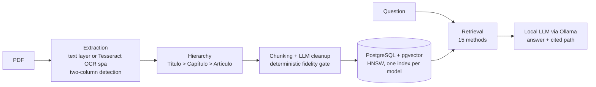

# grounded-rag-es

Source-cited question answering over **Spanish-language** regulations, running on local hardware.

## 1. What it is

`grounded-rag-es` is an open-source toolkit that turns Spanish-language regulatory PDFs (university statutes, regulations, official gazettes) into a searchable corpus and answers questions from it with a local language model. Every answer is built only from retrieved fragments and cites the document and its hierarchical path (title, chapter and, where the source marks it, article). When the retrieved text does not contain the answer, the model is instructed to say so instead of filling the gap.

The whole pipeline is designed around Spanish: OCR with Tesseract's Spanish model, hierarchy rules for Spanish legal vocabulary (`TÍTULO`, `CAPÍTULO`, `SECCIÓN`, `Artículo`, and Roman-numeral clauses known as *fracciones*), and a comparison of embedding models trained on Spanish (BETO, MarIA, RoBERTalex, Sim-ES) against multilingual ones. Code identifiers, logs and the web interface are in Spanish because the intended users are Spanish-speaking institutions; the documentation is in English.

## 2. Why

General-purpose AI chatbots invent articles, deadlines and requirements when asked about a specific regulation. For a student, a made-up requirement can mean a lost procedure.

Retrieval-augmented generation (RAG) addresses this by making the model answer from the institution's own documents, but the evidence for it comes almost entirely from other languages. In our systematic review of retrieval-augmented systems applied to institutional regulations (Mariano Ruiz et al., 2026), **none of the 24 studies in the synthesis used a Spanish-language corpus**. Their corpora were in English (11), Vietnamese (4), Chinese (2), Indonesian (2), Polish, Romanian, Russian and Thai (1 each). None came from a Latin American institution with an empirical evaluation. The two most careful studies on languages that are under-represented in the base models found that this under-representation hurts performance, so results on English corpora cannot simply be assumed to hold for Spanish.

We also found no public tool or evaluation set for question answering over Spanish-language university regulations. This repository is a first step toward both.

## 3. How it works



- **Extraction.** Native text layer through pdfplumber when it is usable. Otherwise, page-level OCR with Tesseract (Spanish, 400 dpi, OpenCV preprocessing). Two-column pages are detected by the gap between columns and split, so lines from both columns are not merged.
- **Hierarchy reconstruction.** Font size, bold and Spanish legal markers rebuild the path `Título > Capítulo > Sección > Artículo` for every block of text. Gazettes are detected as narrative documents and handled separately.
- **Chunking.** Each node of the tree becomes one or more fragments (up to 1,500 characters, 200 overlap) that carry their hierarchical path inside the text that gets embedded.
- **Fidelity gate.** A small local model (`llama3.2:3b`) cleans OCR noise. Its output is accepted only if `difflib` similarity with the source is **≥ 0.55** and the length ratio is **between 0.4 and 2.0**. Otherwise the original text is kept and the case is logged for review. The check is a fixed rule, not another model.
- **Storage.** PostgreSQL with pgvector, one vector column and one HNSW index per embedding model.
- **Generation.** Local models through Ollama (`qwen2.5:3b` by default), with a prompt that restricts the answer to the retrieved context, asks for the hierarchical path and asks the model to say when the context does not contain the answer.
- **Retrieval comparison.** The search service runs the same question through **15 methods side by side**, with their answers and latencies: 12 dense embedding models, Doc2Vec, BM25 and TF-IDF. A 13th dense model, BGE-M3, is already indexed and will be added to the comparison screen.

| Group | Models |
|---|---|
| Spanish | BETO, MarIA (`roberta-base-bne`), RoBERTalex (Spanish legal), Sim-ES |
| Multilingual | mBERT, Legal-XLM-R large, multilingual E5 large and base, multilingual MPNet, multilingual MiniLM, DistilUSE, BGE-M3 |
| English baseline | SimCSE (RoBERTa base) |
| Classic | Doc2Vec, BM25, TF-IDF |

Details: [docs/architecture.md](docs/architecture.md). Ingestion API: [docs/INTEGRATION_GUIDE.md](docs/INTEGRATION_GUIDE.md).

## 4. Current status

The first test case is the Universidad Autónoma de Guerrero (UAGro), Mexico:

- **105 documents** processed: 52 regulations and statutes, and 53 issues of the official gazette.
- **6,291 fragments** with hierarchical paths: 2,101 from regulations and 4,190 from gazettes.
- **13 dense models plus Doc2Vec** vectorized for every fragment.
- Runs **fully on local hardware, CPU only** for now. Documents and questions are never sent to an external API.

The corpus was provided under an agreement with the university and is not redistributed here. [`examples/`](examples/) contains a public extract of the university's general statute with the output of every stage, so the pipeline can be tested without the corpus or a database.

What does not work well yet, measured on the corpus and shown in the example:

- **Fragments are section-level, not always article-level.** Article headings that end in a period (`Artículo 13.`) are not promoted to their own level, so several articles can share a fragment whose path ends at the chapter. In the regulations, 195 of 2,101 fragments begin exactly at an article and 647 contain more than one.
- **The fidelity gate catches additions better than omissions.** It rejected an invented sentence in the example, but it also accepted a cleanup that dropped a whole article. Across the corpus, 368 accepted fragments (5.8 %) are shorter than 80 % of their source text. Some of that is legitimate noise removal, and some is lost content.
- **Abstention has not been measured.** "Say so when the context does not contain the answer" is a prompt instruction today, not an evaluated behavior.

## 5. Quick install

**Requirements**

- Python 3.11 or newer (tested on 3.12, Ubuntu 24.04)
- Tesseract OCR with Spanish data, and Poppler
- PostgreSQL with pgvector (only for the full pipeline and the search service)
- [Ollama](https://ollama.com) with `qwen2.5:3b` and `llama3.2:3b`

```bash
sudo apt install tesseract-ocr tesseract-ocr-spa poppler-utils
ollama pull qwen2.5:3b
ollama pull llama3.2:3b

git clone https://github.com/DavidMariano300/grounded-rag-es.git
cd grounded-rag-es
python3 -m venv .venv
source .venv/bin/activate
pip install -r requirements.txt
```

**Try it with the example (no database needed).** This runs extraction, hierarchy and chunking on the statute extract and prints what goes in and out of each stage:

```bash
python despliegue/demo_pipeline.py examples/estatuto_general/estatuto_general_extracto.pdf \
       --categoria 00_MARCO_CONSTITUCIONAL --sin-pausas --conservar
```

Compare your results in `data/demo_pipeline/` with [`examples/estatuto_general/output/`](examples/estatuto_general/output/).

**Full pipeline on your own documents.** Run from the repository root:

```bash
sudo apt install postgresql postgresql-16-pgvector
cp .env.example .env              # fill in your values; never commit .env
set -a; source .env; set +a
python despliegue/verificar_entorno.py

python pipeline/00_init_db.py     # creates the table and HNSW indexes
# put PDFs in data/01_raw_pdf/<category>/   (categories: docs/architecture.md)
python pipeline/01_extraccion.py
python pipeline/02_arbol_semantico.py
python pipeline/03_chunker_semantico.py
python pipeline/quality_report.py
python pipeline/04_vectorizacion_masiva.py   # rebuilds the table from scratch

python app/server/app.py          # http://127.0.0.1:5000/benchmark-RAG/
```

To add documents one at a time without rebuilding, use the ingestion service (`python -m app.ingesta.servicio`), described in the [integration guide](docs/INTEGRATION_GUIDE.md).

## 6. Roadmap

1. **Public Spanish evaluation set.** 100 to 200 questions over Spanish-language university regulations, each validated by people who know the regulations, with the expected source article, and including questions the corpus cannot answer so that abstention can be measured.
2. **Model and chunking comparison report.** The 15 retrieval methods and at least two segmentation strategies (section-level as today, and true article-level) evaluated on that set, with retrieval metrics, answer faithfulness and latency on CPU.
3. **Fidelity gate against omissions.** Add a coverage check (share of source content present in the cleaned text) and log every fragment the model discards.
4. **Packaging for other institutions.** Configurable hierarchy rules for other Spanish-language regulatory styles, a single-command setup, and documentation for adding a new institution's corpus.

## 7. Citation

If you use this work, please cite the systematic review that motivates it:

> Mariano Ruiz, E. D., Catalán Villegas, A., Hernández de la Cruz, M., & Cuevas Valencia, R. E. (2026). Revisión sistemática de la literatura: Aplicación de sistemas de recuperación de información, NLP y arquitecturas RAG en el dominio jurídico-administrativo de instituciones educativas. *Revista FEGLININ*, *10*(37), 70–78. https://doi.org/10.70417/S3OdE4cnB27

## 8. Author and license

**Edgar David Mariano Ruiz**, Maestría en Ingeniería para la Innovación y Desarrollo Tecnológico (MIIDT), Facultad de Ingeniería, Universidad Autónoma de Guerrero, Mexico. ORCID [0009-0005-6171-1206](https://orcid.org/0009-0005-6171-1206).

Advisors: Dr. Arnulfo Catalán Villegas and Dra. Mercedes Hernández De La Cruz.

- **Code:** [MIT License](LICENSE).
- **Example data** in `examples/` (pipeline outputs): [CC BY 4.0](https://creativecommons.org/licenses/by/4.0/). The source text is a public university regulation; see [examples/README.md](examples/README.md).
