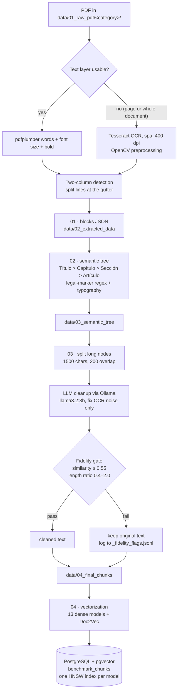
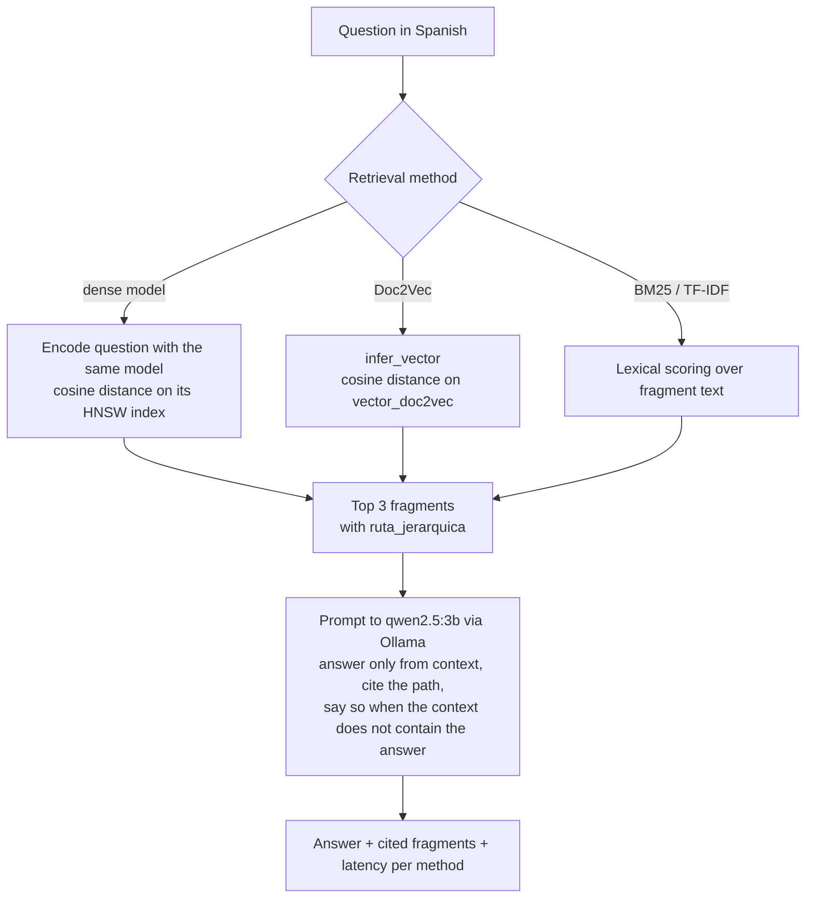

# Architecture

The system has two phases that share one PostgreSQL table (`benchmark_chunks`).

- **Curation phase** (offline, run once per document): turns a PDF into fragments with a hierarchical path and stores one vector per embedding model.
- **Query phase** (online): retrieves the top fragments for a question with the selected method and asks a local LLM to answer only from them, citing the path.

## Curation phase

| Stage | Script | Output |
|---|---|---|
| 0 | `pipeline/00_init_db.py` | Table `benchmark_chunks`, one `vector(n)` column and one HNSW index per model |
| 1 | `pipeline/01_extraccion.py` | Line blocks with font size, bold flag and origin (`nativo` or `ocr`) |
| 2 | `pipeline/02_arbol_semantico.py` | Nodes with `ruta_jerarquica` (list of headings) and `texto_fragmento` |
| 3 | `pipeline/03_chunker_semantico.py` | Final fragments: `documento_origen`, `ruta_jerarquica`, `texto_para_vectorizar` |
| 4 | `pipeline/04_vectorizacion_masiva.py` | Rows in `benchmark_chunks` with all vector columns filled |
| QA | `pipeline/quality_report.py` | Per-document report: empty paths, oversized fragments, fidelity flags |

The fidelity gate is deterministic: it compares the LLM output with the input using `difflib.SequenceMatcher` and a length ratio. It does not judge meaning; it only blocks rewrites that drift too far from the source, which is where small models tend to invent text. A cleanup that fails is discarded and the original text is stored instead, so a fragment is never lost because of the LLM.

The ingestion service (`app/ingesta/servicio.py`) runs stages 1 to 4 for a single uploaded PDF in a background worker, so new documents can be added without rerunning the whole corpus. See [INTEGRATION_GUIDE.md](INTEGRATION_GUIDE.md).

## Query phase

The search service (`app/server/app.py`, route `POST /benchmark-RAG/search`) runs the same question through several methods side by side, so retrieval quality and latency can be compared on the same screen. It exposes 15 methods: 12 dense models, Doc2Vec, BM25 and TF-IDF. BGE-M3 is vectorized and indexed by stage 4 and by the ingestion service but is not yet in the comparison screen.

Abstention is currently a prompt instruction. It has not been measured yet; measuring it is part of the public evaluation set in the roadmap.

## Categories

PDFs live in `data/01_raw_pdf/<category>/`. The folder name is stored in each row and is used to filter and to report per category. The numbering is the one used by the corpus and the database; the ingestion service validates uploads against the same list (`app/ingesta/config.py`).

| Folder | Content |
|---|---|
| `00_MARCO_CONSTITUCIONAL` | Organic law, general statute, rules of the university council |
| `01_NORMATIVA_ACADEMICA_ESTUDIANTIL` | Student and academic regulations |
| `02_DERECHOS_HUMANOS_E_INCLUSION` | Rights, equality, inclusion, protocols |
| `03_INVESTIGACION_Y_POSGRADO` | Research, graduate studies, libraries, publishing |
| `04_GOBERNANZA_Y_ADMINISTRACION` | Governance bodies, administration, finance |
| `99_GACETAS_HISTORICAS` | Official gazettes; treated as narrative documents in stage 2 |

An earlier draft of the ingestion service used a different order (`01_MARCO_CONSTITUCIONAL`, `02_GOBERNANZA…`, `03_NORMATIVA…`, `04_INVESTIGACION…`, `05_DERECHOS…`). It was never deployed and has been replaced by the scheme above.
